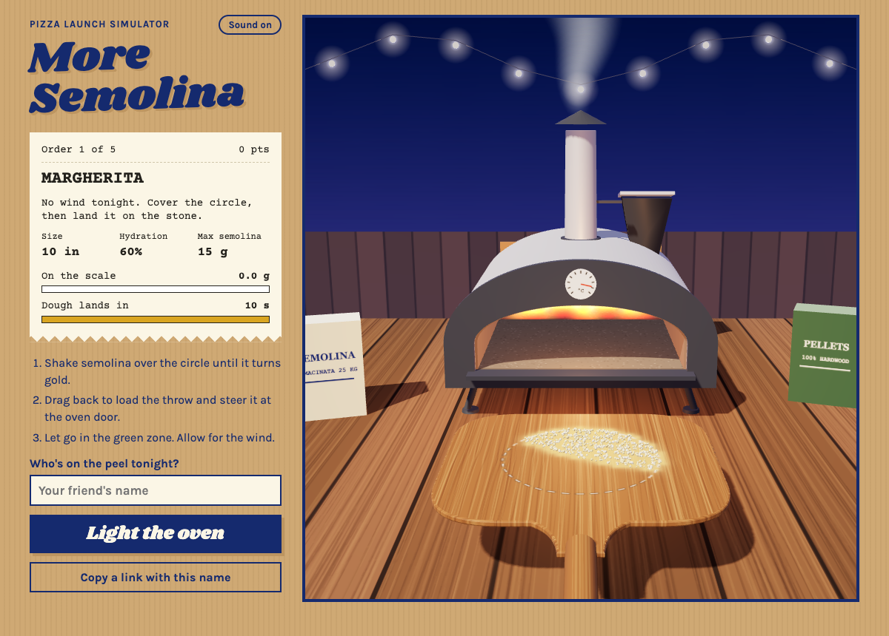

# More Semolina

A browser game about the one thing every home pizza maker gets wrong: not enough semolina on the peel.

**Play it:** https://more-semolina.statiq.page/



## How to play

1. **Dust the peel.** Hold and drag to shake semolina over the dashed circle until it turns gold. Bare patches stick, and going over the semolina limit burns on the stone.
2. **Throw the pizza.** Drag down to pull the peel back, steer at the oven door, and let go when the needle is in the green zone.
3. **Allow for the wind.** The chimney smoke shows which way it blows. Sticky dough needs a harder throw, too much semolina makes it slide further, and dough left sitting on the peel starts to stick.

There are five pizzas, each bigger and wetter than the last. At the end you get a rank and a score card picture to send to whoever needs to see it.

Keyboard players can use the arrow keys and hold the space bar.

## Send it to a friend by name

Add `?chef=` and their name to the link, and the game greets them by name:

```
https://more-semolina.statiq.page/?chef=Dave
```

The **Copy a link with this name** button on the start screen builds this link for you.

## How it's built

Everything is in `index.html`: plain HTML, CSS and JavaScript with [three.js](https://threejs.org/) r128 loaded from cdnjs. There is no build step. Open the file in a browser (with an internet connection for three.js and Google Fonts), or serve the folder with any static host.

The site is hosted on statiq.page, which redeploys whenever `main` is pushed.
